<div align="center">
  
</div>

<br/>

<table>
<tr>
<td width="64%" valign="top">

### Hey, I'm Abhi. <sup>✳</sup>

I like the space where **a useful idea becomes a product people actually want to use.**

I design interfaces, build the systems behind them, and keep refining the little things that make software feel effortless.

Not just screens. **The whole experience.**

</td>
<td valign="top">

```js
const approach = {
  curiosity: "always",
  detail: "intentional",
  mindset: "ship & improve",
};
```

</td>
</tr>
</table>

<div align="center">
<a href="https://github.com/abhijeeth-dev-25/portfolio"></a>
<a href="mailto:abhijeethkar.geddam.dev@gmail.com"></a>
</div>

<br/>

### THE WORK <sup>↘</sup>

*Not a list of everything I've tried. A few things worth opening.*

<table>
<tr>
<td width="50%" valign="top">

<sub>01 / BUILDING FOR THE REAL WORLD</sub>

## [MenuDot ↗](https://menudot.vercel.app)

**A better flow for the dining table.**

Exploring how ordering, QR dining and restaurant operations can work as one connected experience.

<a href="https://menudot.vercel.app">Explore the product ↗</a>

</td>
<td width="50%" valign="top">

<sub>02 / BUILDING FOR BUILDERS</sub>

## [JS Pulse ↗](https://github.com/abhijeeth-dev-25/js-pulse)

**What if data structures weren't invisible?**

A VS Code extension that turns running JavaScript structures into diagrams you can explore.

<a href="https://github.com/abhijeeth-dev-25/js-pulse">Explore the code ↗</a>

</td>
</tr>
<tr>
<td width="50%" valign="top">

<sub>03 / FULL-STACK PRODUCT</sub>

## [Grain ↗](https://github.com/abhijeeth-dev-25/Grain)

**Learning deserves a thoughtful interface.**

An educational marketplace combining course discovery, role-based experiences and authentication.

<a href="https://github.com/abhijeeth-dev-25/Grain">Explore the build ↗</a>

</td>
<td width="50%" valign="top">

<sub>04 / THE DIGITAL PLAYGROUND</sub>

## [Portfolio ↗](https://github.com/abhijeeth-dev-25/portfolio)

**A place where the projects tell the story.**

Interactive case studies, a 3D project viewer, and experiments in a more expressive developer portfolio.

<a href="https://github.com/abhijeeth-dev-25/portfolio">Enter the playground ↗</a>

</td>
</tr>
</table>

<br/>

### THE WAY I BUILD <sup>↘</sup>

```text
AN IDEA
   │
   ├── Is it useful?          → product thinking
   ├── Does it feel right?    → interface & interaction
   ├── Can it hold up?        → architecture & APIs
   └── Can it get better?     → testing & iteration
                                 │
                                 ▼
                             SHIP / LEARN / REPEAT
```

<sub>TOOLS I REACH FOR</sub>

**TypeScript · JavaScript · React · Node.js · Express · MongoDB · CSS · Git**

<sub>AND I'M ALWAYS EXPLORING THE NEXT THING.</sub>

<br/>

---

<div align="center">

### Good ideas deserve to be built.

If you're working on something interesting, I'd love to hear about it.

**[Say hello ↗](mailto:abhijeethkar.geddam.dev@gmail.com)** &nbsp; / &nbsp; **[Browse all experiments ↗](https://github.com/abhijeeth-dev-25?tab=repositories)**

<br/>

<sub>ABHIJEETHKAR GEDDAM &nbsp; / &nbsp; BUILT WITH INTENTION, NOT A TEMPLATE.</sub>

</div>
